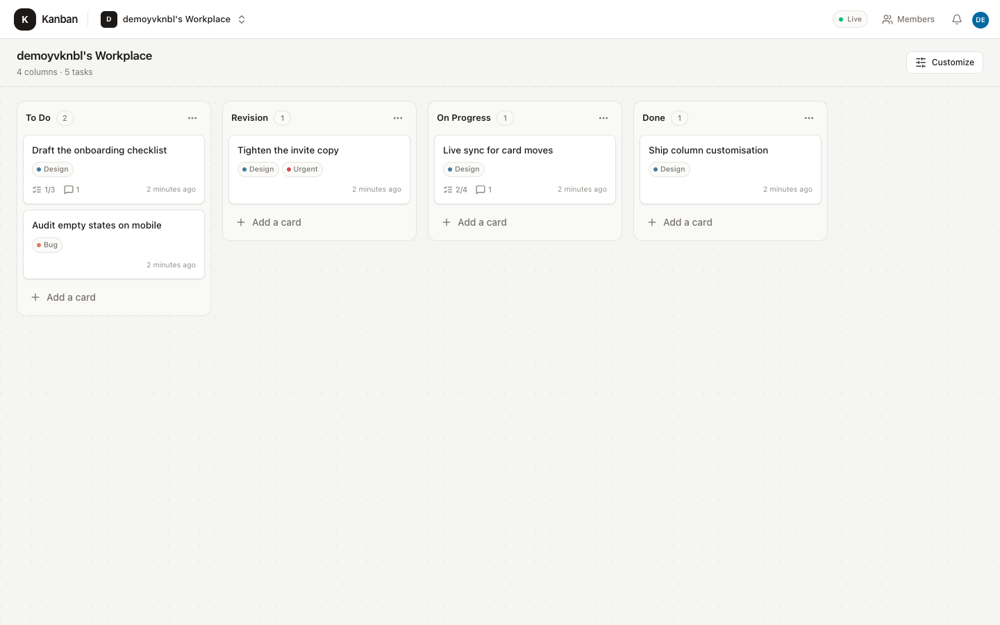
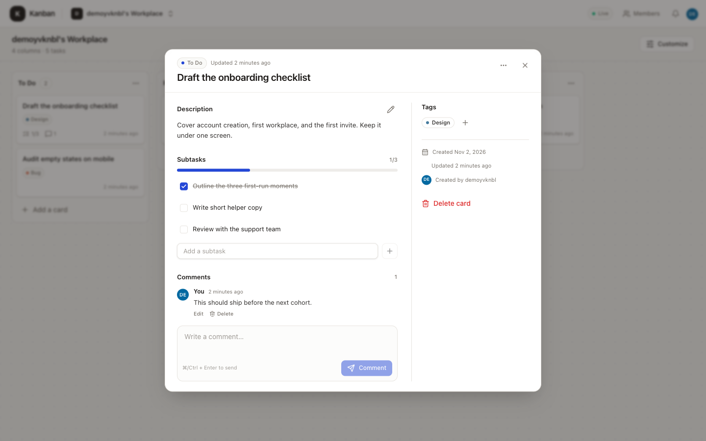

Kanban is a Trello-style board for small teams: one workplace, four clear lanes, and every task —
checklist, tags, comments — moving live with the people who care about it.

> 📘 **Screenshots use a throwaway demo account.** No real user data is shown.

## What you get

- **A workplace per account** — registering `ada` creates `ada's Workplace` with the columns
  **To Do → Revision → On Progress → Done**.
- **Owner-controlled columns** — rename, reorder, hide without deleting cards, add, and delete.
  Deleting a column moves its cards to the first visible remaining column.
- **Rich cards** — Markdown description with Write/Preview, checklists, colored tags, multiple
  assignees, and a comment thread.
- **Cross-column drag and drop** — mouse, touch, and keyboard, with server-side ordering that
  survives reload.
- **Realtime** — Socket.IO keeps every member's board in sync as work moves.
- **Invitations and roles** — the owner manages structure, invitations, members, and tags; members
  work on cards.
- **Guided sign-up** — usernames and emails are checked live, a strength meter enforces a stronger
  password, and reserved names are rejected.
- **AI access** — an MCP server exposes 39 board tools, so Claude, Cursor, Codex, or any MCP client
  can work the board without opening a browser.

## Two ways to use it

| Interface      | Best for                                                                      |
| :------------- | :---------------------------------------------------------------------------- |
| **Web app**    | People who want to see, drag, and discuss work on a board                     |
| **MCP server** | AI clients and automations that should create, move, and update work directly |

Both talk to the same API, so changes made by an AI show up live in an open browser.

## Where to go next

- [Quick start](/docs/quickstart) — run the app locally in five steps.
- [How it works](/docs/concepts) — workplaces, roles, ordering, and realtime.
- [MCP server](/docs/mcp) — connect an AI client to the board.
- [Configuration](/docs/configuration) — environment variables and security settings.
- [Deploy](/docs/deployment) — put it on Render, Railway, Fly.io, or any Docker host.
